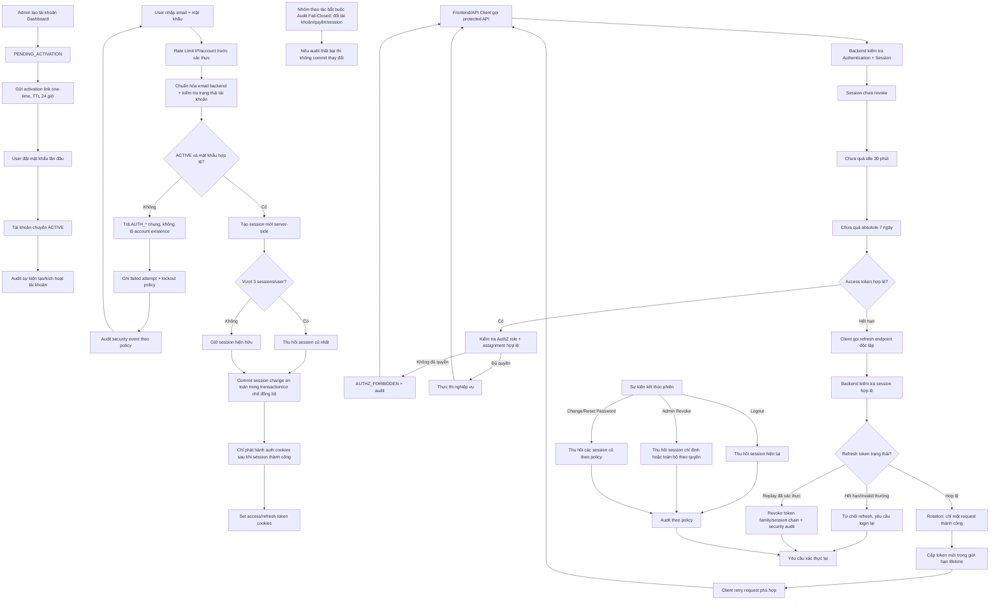
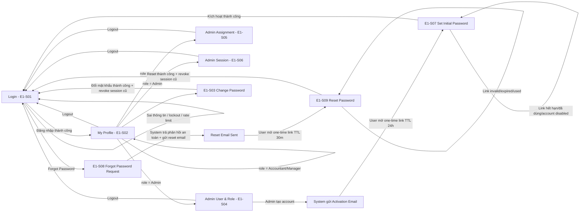
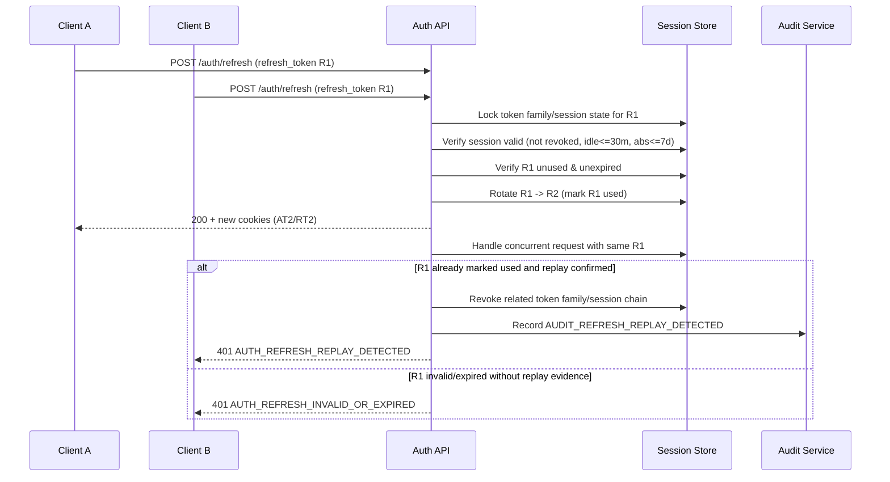
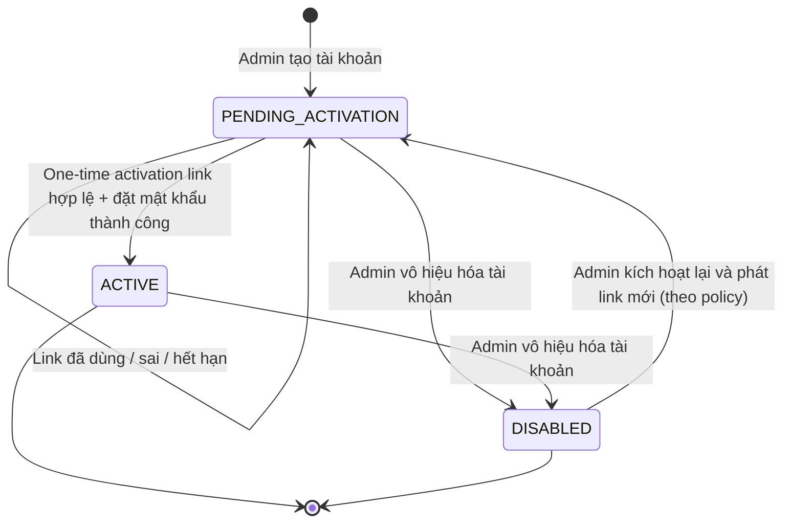
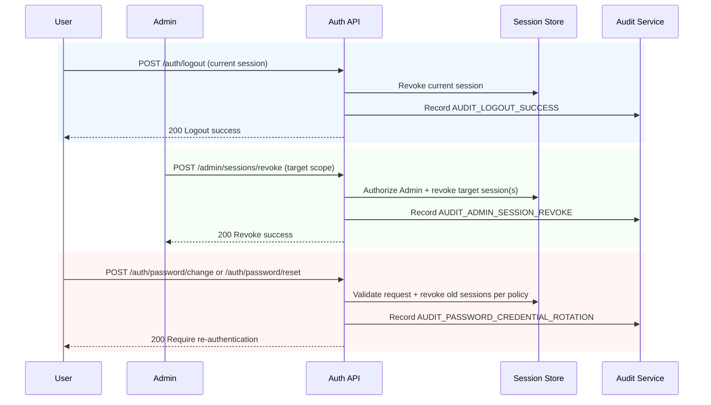

# Specification — Epic 1: Project Foundation & Authentication

**Project**: Accounting Intake Agent  
**Date**: 2026-10-29 10:00 (Format: yyyy-MM-dd HH:mm — update each time spec.md is edited)  
**Version**: 4.1.0.0 (Format: A.B.0.0 — A matches constitution.md; If A differs from constitution.md, use git diff to review changes; Increment B each time spec.md is edited)  
**Source of truth**: `docs/overview/constitution.md` (Version `4.0.0.0`)  
**Spec chính thức của Epic 1** (quyết định 2026-10-29). Nội dung `docs/E1-ProjectFoundationAuthentication/spec.tmp.md` đã hợp nhất vào mục 7.  
**Epic**: `4.1 Epic 1: Project Foundation & Authentication`  
**Status**: Updated draft for implementation planning — chờ duyệt các điểm C1–C8 (mục 7.8)

---

## 1) Scope Guardrails (Locked)

1. Giữ nguyên 10 Epic đã chốt trong Constitution.
2. Không mở rộng ngoài MVP V1 scope.
3. Giữ nguyên Tech Stack: Python/FastAPI, PostgreSQL (multi-tenant, RLS), Next.js, kênh Zalo (pilot nhập thủ công, chưa Zalo OA), OCR theo kiến trúc đã duyệt, không LLM hoặc dịch vụ AI bên ngoài, Docker.
4. Giữ nguyên Language Policy.
5. Future Roadmap V2–V5 chỉ để tham chiếu, không triển khai trong Epic 1.

---

## 2) Cross-Epic Design Principles (Applied before Epic details)

### DP-001 Authentication Boundary

1. Customer tương tác qua kênh tiếp nhận (Zalo; trong pilot đầu tiên kế toán nhập thủ công thay khách), **không bắt buộc** có tài khoản Web Dashboard trong MVP V1.
2. Dashboard Authentication chỉ áp dụng cho Accountant, Manager, Admin.
3. Mọi route dashboard/API nội bộ phải kiểm tra danh tính và quyền truy cập theo vai trò.

### DP-002 Customer Mapping Model

1. Không giả định quan hệ `1 người gửi trên kênh tiếp nhận = 1 Customer`.
2. Một người gửi (ví dụ một tài khoản Zalo) có thể đại diện nhiều Customer.
3. Khi chưa xác định được ownership, dữ liệu phải vào `UNVERIFIED_QUEUE` và yêu cầu xác minh thủ công.
4. AI không được tự suy đoán ownership nếu thiếu căn cứ.

### DP-003 Centralized Document Lifecycle Control

1. Trách nhiệm Epic 4/6/7 phải dùng **một cơ chế quản lý trạng thái tập trung**.
2. Chuyển trạng thái phải qua validation + authorization + audit log.
3. Không cho phép từng module tự cập nhật `Document Status` tùy ý.

### DP-004 Testable Acceptance Criteria Quality

1. Acceptance Criteria phải có đủ happy path, error path, retry, duplicate, uncertainty, concurrency, authorization.
2. Mỗi AC phải kiểm thử được bằng điều kiện đầu vào và kết quả mong đợi rõ ràng.

### DP-005 Tenant Isolation

1. Mỗi công ty dịch vụ kế toán là một tenant; mọi dữ liệu nghiệp vụ, user, session và audit gắn `tenant_id`.
2. Cô lập tenant được thực thi bằng PostgreSQL Row Level Security dưới role ứng dụng không phải superuser, không BYPASSRLS (Constitution mục 3.14).
3. Kiểm tra authz ở tầng API không thay thế RLS; RLS không thay thế authz theo vai trò.

---

## 3) Epic 1 Specification — Project Foundation & Authentication

### 3.1 Objective

Thiết lập nền tảng kỹ thuật và bảo mật cho MVP V1, bao gồm authentication/authorization cho dashboard users (Accountant/Manager/Admin), session tracking phía server, chuẩn audit log và error/reason codes dùng chung, để Epic 2–10 triển khai nhất quán, an toàn, có khả năng truy vết.

### 3.2 In Scope

1. Dashboard authentication cho Accountant/Manager/Admin.
2. RBAC cơ bản theo vai trò.
3. Session/token lifecycle: access token, refresh token, rotation, revoke.
4. Login protection: retry/lockout/rate limit cho auth endpoints.
5. Chuẩn hóa auth/authz error codes và audit reason codes.
6. Chuẩn hóa audit envelope cho các hành động bảo mật/nghiệp vụ nhạy cảm.
7. Thiết lập nguyên tắc cấu hình secrets/environment (không hard-code).
8. Nền tảng idempotency/correlation ID ở mức framework cho API nội bộ.
9. Guardrails kỹ thuật để hỗ trợ `UNVERIFIED_QUEUE` và lifecycle control ở các Epic sau.

### 3.3 Out of Scope

1. Đăng nhập web cho Customer.
2. OCR, intent classification, validation nghiệp vụ chi tiết.
3. Workflow xác minh người gửi ↔ Customer chi tiết (thực thi ở Epic 3), chỉ chuẩn bị nền tảng authz/audit.
4. Follow-up workflow gửi yêu cầu bổ sung cho khách (Epic 7).
5. Export schema chi tiết (Epic 9).
6. Bắt buộc triển khai MFA cho Admin trong MVP V1 (chỉ yêu cầu MFA-ready architecture).

### 3.4 Actors

1. **Admin**: quản trị user dashboard và phân quyền.
2. **Manager**: giám sát, truy cập báo cáo và phạm vi quản lý được cấp.
3. **Accountant**: thao tác xử lý chứng từ/exceptions theo phân quyền.
4. **System Service**: backend services thực thi workflow, ghi audit, áp dụng authz.
5. **Customer (channel-only actor)**: tác nhân nghiệp vụ gửi chứng từ qua kênh tiếp nhận (Zalo), không thuộc dashboard auth trong MVP V1.

### 3.5 Inputs / Outputs

#### Inputs

1. Vai trò chuẩn: Customer, Accountant, Manager, Admin.
2. Policy từ Constitution: Human-in-the-loop, AI Uncertainty Handling, Document/Exception lifecycle.
3. Quyết định thiết kế xác nhận: token+server session, lockout policy, MFA-ready, code catalog chuẩn.

#### Outputs

1. Cơ chế đăng nhập dashboard cho Accountant/Manager/Admin.
2. RBAC enforcement trên API/dashboard actions.
3. Chuẩn audit log: actor, action, resource, timestamp, result, correlation_id, reason_code.
4. Chuẩn idempotency/correlation để các Epic sau dùng cho retry/duplicate safety.
5. Chuẩn error codes/reason codes dùng chung cho auth/authz và audit.
6. Chính sách từ chối truy cập mặc định (deny-by-default) cho mọi endpoint cần bảo vệ.

### 3.6 Functional Requirements

- **FR-E1-001 (Dashboard Authentication)**: Hệ thống phải cung cấp cơ chế xác thực cho Accountant/Manager/Admin truy cập dashboard.
- **FR-E1-002 (Role-Based Authorization)**: Hệ thống phải áp dụng RBAC cho mọi API/dashboard action thuộc phạm vi quản trị và nghiệp vụ kế toán.
- **FR-E1-003 (Customer Web Exclusion)**: Hệ thống không yêu cầu hoặc cấp dashboard login cho Customer trong MVP V1.
- **FR-E1-004 (Session/Token Control)**: Hệ thống phải dùng mô hình `access token + refresh token + server-side session tracking`.
- **FR-E1-005 (Token Lifetime Policy)**: Access token có thời hạn 15 phút; refresh token tối đa 7 ngày.
- **FR-E1-006 (Refresh Rotation & Revocation)**: Hệ thống phải hỗ trợ refresh token rotation, logout, session revocation, và invalidate token cũ sau refresh.
- **FR-E1-007 (Refresh Token Storage Security)**: Chỉ lưu hash refresh token; không lưu plaintext refresh token.
- **FR-E1-008 (Cookie & CSRF Security)**: Token phải truyền/lưu theo cơ chế `HttpOnly + Secure + SameSite` cookies và có CSRF protection phù hợp.
- **FR-E1-009 (No LocalStorage Token)**: Không lưu access/refresh token trong localStorage.
- **FR-E1-010 (Login Protection Policy)**: Áp dụng lockout: 5 lần login sai/15 phút/tài khoản thì khóa 15 phút, kết hợp rate limit theo IP và account.
- **FR-E1-011 (Non-Enumerating Auth Errors)**: Thông báo login lỗi không tiết lộ tài khoản có tồn tại hay không.
- **FR-E1-012 (Audit Envelope Standard)**: Mọi hành động nhạy cảm (auth, role change, approval-related operations) phải ghi audit theo schema thống nhất.
- **FR-E1-013 (Error/Reason Code Catalog)**: Hệ thống phải định nghĩa catalog error codes cho auth/authz và catalog reason codes cho audit events.
- **FR-E1-014 (Secrets & Config Security)**: Secrets phải lấy từ environment/secret manager; cấm hard-code trong source/config committed.
- **FR-E1-015 (Authorization Guardrails for Future Flows)**: Các endpoint thay đổi trạng thái nghiệp vụ phải dùng middleware/policy check chuẩn để hỗ trợ centralized lifecycle control ở Epic 4/6/7.
- **FR-E1-016 (Request Correlation & Idempotency Foundation)**: API foundation phải hỗ trợ correlation ID và idempotency key handling cho các thao tác cần retry-safe.
- **FR-E1-017 (Multi-Customer Mapping Readiness)**: Mô hình phân quyền và identity phải không khóa cứng giả định `1 người gửi trên kênh tiếp nhận = 1 Customer`.
- **FR-E1-018 (Unverified Queue Access Control Readiness)**: Chuẩn phân quyền phải sẵn sàng cho việc chỉ Accountant/Manager/Admin phù hợp mới được thao tác dữ liệu `UNVERIFIED_QUEUE` ở Epic 3.
- **FR-E1-019 (MFA-ready Architecture)**: Authentication architecture không được cản trở việc bổ sung MFA cho Admin ở phase sau.
- **FR-E1-020 (Password Policy Baseline)**: Password dashboard users tối thiểu 12 ký tự, hỗ trợ passphrase, hash bằng Argon2id.
- **FR-E1-021 (Password Reset Security)**: Password reset dùng token một lần, TTL ngắn, và không tiết lộ tài khoản có tồn tại hay không.
- **FR-E1-022 (Manager Assignment Scope Enforcement)**: Manager chỉ truy cập resource thuộc assignment hợp lệ do Admin quản lý; mặc định deny khi thiếu assignment.
- **FR-E1-023 (Refresh/Sensitive Endpoint Rate Limit)**: Endpoint refresh token và endpoint nhạy cảm phải có rate limit riêng theo policy.
- **FR-E1-024 (Configurable Security Thresholds)**: Ngưỡng lockout/rate-limit phải cấu hình được qua environment variables.
- **FR-E1-025 (Tenant Isolation)**: Mọi bảng chứa dữ liệu tenant phải bật và FORCE Row Level Security; ứng dụng chỉ truy cập dữ liệu qua role không có BYPASSRLS; khi chưa xác định tenant thì không trả dữ liệu tenant nào. Hàm chạy với quyền nâng cao (SECURITY DEFINER) phải được rà soát để không làm lộ hoặc thay đổi dữ liệu của tenant khác.

- **FR-E1-026 (Account Activation)**: Tài khoản do Admin tạo ở trạng thái `PENDING_ACTIVATION`; người dùng đặt mật khẩu lần đầu qua link một lần, hạn 24 giờ, lưu dạng hash; thành công thì chuyển `ACTIVE`; tài khoản `DISABLED` không kích hoạt được (E1-FR03, E1-D04). Kênh chuyển link: xem C4.
- **FR-E1-027 (Session Lifecycle)**: Idle timeout 30 phút; refresh token hết hạn tuyệt đối sau 7 ngày tính từ lúc đăng nhập (không trượt); tối đa 3 session mỗi user, session thứ 4 thu hồi session cũ nhất; mọi request được kiểm tra session trước khi xử lý nghiệp vụ (E1-FR08).
- **FR-E1-028 (Change Password)**: User đổi mật khẩu của chính mình sau khi xác thực mật khẩu hiện tại; đổi hoặc đặt lại mật khẩu thành công thì thu hồi toàn bộ session cũ và yêu cầu đăng nhập lại. Reset token hạn 30 phút; cấp token mới làm token cũ mất hiệu lực (E1-FR09, E1-QA14, E1-QA28).
- **FR-E1-029 (Refresh Replay Response)**: Với nhiều request refresh đồng thời cùng một token, chỉ một request rotate thành công; replay đã xác thực làm thu hồi token family/session chain và ghi audit mức cao; token hết hạn hoặc sai thông thường chỉ bị từ chối (E1-FR07, E1-NR07, E1-QA15).
- **FR-E1-030 (Audit Fail-Closed)**: Thay đổi tài khoản, role, assignment, session không được commit nếu không ghi được audit bắt buộc (E1-FR12, E1-QA16).
- **FR-E1-031 (Bootstrap Admin)**: Admin đầu tiên được tạo một lần từ cấu hình môi trường và bắt buộc đổi mật khẩu ở lần đăng nhập đầu (E1-QA12).
- **FR-E1-032 (Login Identifier)**: Đăng nhập bằng email; backend trim, lowercase và so khớp không phân biệt hoa thường (E1-QA01, E1-QA05). Phạm vi duy nhất của email: xem C5.
- **FR-E1-033 (Weak Password Blocklist)**: Ngoài độ dài tối thiểu 12 ký tự, chặn mật khẩu yếu phổ biến; không bắt buộc quy tắc phức tạp cứng; chưa bắt buộc kiểm tra lịch sử mật khẩu (E1-QA17, E1-QA18 deferred).
- **FR-E1-034 (Own Profile)**: User xem và sửa thông tin cá nhân được phép (tên hiển thị, số điện thoại) của chính mình; không tự đổi role, assignment hay trạng thái tài khoản (E1-S02).
- **FR-E1-035 (Cookie Policy by Environment)**: Production dùng cookie `HttpOnly`, `Secure`, `SameSite=Strict`; CSRF kiểm tra cho mọi request thay đổi trạng thái; local dev có cấu hình riêng (E1-NR03, E1-QA08).
- **FR-E1-036 (Local Runtime)**: Backend, frontend, PostgreSQL chạy bằng Docker Compose, có health check và file mẫu cấu hình không chứa secret thật (E1-FR01, E1-NR10).

### 3.7 Business Rules

- **BR-E1-001**: Chỉ Admin mới được tạo/sửa/vô hiệu hóa dashboard user accounts.
- **BR-E1-002**: Customer không có dashboard account trong MVP V1; mọi tương tác Customer đi qua kênh tiếp nhận (Zalo; trong pilot đầu tiên kế toán nhập thủ công thay khách).
- **BR-E1-003**: Mọi quyết định ảnh hưởng dữ liệu kế toán phải truy vết được qua audit log với actor rõ ràng.
- **BR-E1-004**: Authorization áp dụng nguyên tắc deny-by-default khi role/policy không rõ ràng.
- **BR-E1-005**: Không dùng confidence score làm điều kiện duy nhất để bypass human approval/authorization.
- **BR-E1-006**: Secrets lộ trong repository được coi là vi phạm nghiêm trọng và phải chặn release.
- **BR-E1-007**: Thao tác retry phải không tạo side-effect trùng nếu có cùng idempotency context.
- **BR-E1-008**: Sau 5 lần đăng nhập sai trong 15 phút cho cùng account, account bị khóa tạm 15 phút.
- **BR-E1-009**: Hệ thống phải áp dụng rate limiting đồng thời theo account và IP cho login endpoints.
- **BR-E1-010**: Response lỗi login không phân biệt account không tồn tại và password sai.
- **BR-E1-011**: Không lưu secrets/password/access token/refresh token vào logs hoặc audit payload.
- **BR-E1-012**: Pilot với dữ liệu thật không được cho phép khi chưa hoàn tất security review (bao gồm đánh giá MFA cho Admin).
- **BR-E1-013**: IP login rate limit mặc định: 30 lần trong 5 phút, vượt ngưỡng trả HTTP 429.
- **BR-E1-014**: Không khóa vĩnh viễn account hoặc IP trong MVP V1.
- **BR-E1-015**: Audit reason codes dùng taxonomy `AUDIT_*` ổn định, độc lập ngôn ngữ hiển thị.
- **BR-E1-016**: User, session và mọi thao tác chỉ thuộc một tenant; không có thao tác nào của tenant này đọc, sửa, xóa hoặc tham chiếu được dữ liệu của tenant khác.
- **BR-E1-017**: Bộ đếm đăng nhập sai của account được reset về 0 sau khi đăng nhập thành công (E1-QA19).
- **BR-E1-018**: Manager không quản trị assignment; chỉ xem dữ liệu trong phạm vi assignment hợp lệ (E1-QA11). Định nghĩa chi tiết “assignment hợp lệ” deferred sang Epic 3 (E1-QA27).

### 3.8 User Stories

- **US-E1-001 (Admin Authentication Setup)**: Là Admin, tôi muốn quản lý dashboard accounts theo vai trò để kiểm soát ai được truy cập hệ thống.
- **US-E1-002 (Accountant Secure Access)**: Là Accountant, tôi muốn đăng nhập an toàn và chỉ thấy chức năng đúng vai trò để xử lý nghiệp vụ đúng quyền.
- **US-E1-003 (Manager Oversight Access)**: Là Manager, tôi muốn truy cập phạm vi dữ liệu quản lý được cấp mà không thấy dữ liệu ngoài phạm vi.
- **US-E1-004 (System Auditability)**: Là người vận hành, tôi muốn mọi hành động nhạy cảm được audit để điều tra sự cố và tuân thủ governance.
- **US-E1-005 (Platform Consistency)**: Là team phát triển, tôi muốn dùng cùng cơ chế authz/idempotency/correlation để tránh sai khác giữa các Epic.
- **US-E1-006 (Security Operator Protection)**: Là Security/Ops, tôi muốn có lockout/rate-limit và token rotation để giảm rủi ro brute force và session abuse.

### 3.9 Acceptance Criteria (Given/When/Then)

#### AC-E1-001 — Happy Path: Dashboard login success
**Given** một user role `Accountant` hợp lệ và account đang active  
**When** user gửi thông tin đăng nhập hợp lệ  
**Then** hệ thống cấp access token TTL 15 phút + refresh token TTL tối đa 7 ngày, tạo server-side session, và ghi audit reason `AUDIT_AUTH_LOGIN_SUCCESS`.

#### AC-E1-002 — Authorization boundary for Customer
**Given** một principal được nhận diện là `Customer`  
**When** principal cố truy cập dashboard endpoint yêu cầu dashboard auth  
**Then** hệ thống từ chối với error code chuẩn authz, ghi audit reason `AUDIT_AUTHZ_DENIED`, và không trả thông tin nội bộ nhạy cảm.

#### AC-E1-003 — Error Path: Invalid credentials
**Given** tài khoản dashboard tồn tại nhưng thông tin đăng nhập sai  
**When** user thực hiện login  
**Then** hệ thống từ chối đăng nhập, không cấp token, ghi audit reason `AUDIT_AUTH_LOGIN_FAILED`, và thông điệp lỗi không tiết lộ account có tồn tại hay không.

#### AC-E1-004 — Lockout policy enforcement
**Given** một account có 5 lần login sai trong cửa sổ 15 phút  
**When** có lần login sai tiếp theo trong thời gian khóa  
**Then** hệ thống từ chối với error code lockout, duy trì khóa 15 phút, và ghi audit reason `AUDIT_AUTH_ACCOUNT_LOCKED`.

#### AC-E1-005 — Rate limiting by IP and account
**Given** lưu lượng login vượt ngưỡng rate limit theo IP hoặc account  
**When** yêu cầu mới đến login endpoint  
**Then** hệ thống throttle/reject theo policy, trả HTTP 429 với error code rate-limit chuẩn và ghi audit/security event tương ứng.

#### AC-E1-006 — Refresh rotation success
**Given** refresh token hợp lệ gắn với server-side session active  
**When** client gọi refresh endpoint  
**Then** hệ thống cấp token mới, rotate refresh token, revoke token refresh cũ, và ghi audit reason `AUDIT_AUTH_REFRESH_ROTATED`.

#### AC-E1-007 — Duplicate/replay refresh rejection
**Given** refresh token cũ đã bị rotate/revoke  
**When** token cũ được gửi lại do replay hoặc retry muộn  
**Then** hệ thống từ chối request, không cấp token mới, ghi audit reason `AUDIT_AUTH_REFRESH_REPLAY_REJECTED`.

#### AC-E1-008 — Logout & session revocation
**Given** một session đang active  
**When** user thực hiện logout hoặc Admin revoke session  
**Then** server-side session bị vô hiệu hóa ngay, refresh token không dùng lại được, và ghi audit event phù hợp.

#### AC-E1-009 — Concurrency: role update conflict
**Given** Admin A và Admin B cùng sửa quyền của một user gần đồng thời  
**When** update thứ hai dùng dữ liệu stale (version cũ)  
**Then** hệ thống phát hiện conflict, từ chối update stale, ghi audit `ROLE_UPDATE_CONFLICT`, và giữ trạng thái quyền nhất quán.

#### AC-E1-010 — Authorization: privileged action restriction
**Given** user role `Accountant`  
**When** user gọi API quản trị user/role (chỉ dành cho Admin)  
**Then** hệ thống trả về forbidden với error code chuẩn, không thay đổi dữ liệu, ghi audit reason `AUDIT_AUTHZ_DENIED`.

#### AC-E1-011 — Uncertainty-ready handling baseline
**Given** một request thay đổi trạng thái nghiệp vụ nhưng không đủ context identity/ownership đã xác minh  
**When** request vào lớp API protected cho business-state mutation  
**Then** hệ thống không cho commit trạng thái, route sang trạng thái chờ xác minh/exception theo policy, và ghi audit reason `AUDIT_INSUFFICIENT_VERIFIED_EVIDENCE`.

#### AC-E1-012 — Secret hygiene gate
**Given** pipeline kiểm tra cấu hình phát hiện secret hard-coded trong mã nguồn hoặc file cấu hình bị commit  
**When** chạy security gate của Epic 1  
**Then** build/release gate thất bại và tạo log cảnh báo bảo mật theo chuẩn vận hành.

#### AC-E1-013 — Password policy enforcement
**Given** Admin tạo hoặc reset password cho dashboard user  
**When** password ngắn hơn 12 ký tự hoặc không đạt policy đã định  
**Then** hệ thống từ chối với error code auth chuẩn, không lưu password, và ghi audit event tương ứng.

#### AC-E1-014 — Password reset anti-enumeration
**Given** request password reset với email/username có thể tồn tại hoặc không tồn tại  
**When** endpoint reset được gọi  
**Then** response bên ngoài là thông điệp trung lập, còn hệ thống nội bộ chỉ tạo reset token một lần (TTL ngắn) cho account hợp lệ.

#### AC-E1-015 — Manager assignment-based access
**Given** user role `Manager` có danh sách assignment cụ thể  
**When** Manager truy cập resource ngoài assignment  
**Then** hệ thống từ chối với `AUTHZ_*`, không trả dữ liệu resource, và ghi audit reason `AUDIT_AUTHZ_DENIED`.

#### AC-E1-016 — Concurrent login attempts under protection
**Given** nhiều login attempts đồng thời trên cùng account trong cửa sổ 15 phút  
**When** tổng số lần sai vượt ngưỡng lockout  
**Then** hệ thống khóa tạm account đúng policy, tránh race condition gây sai trạng thái lock.

#### AC-E1-017 — Tenant isolation under application role
**Given** hai tenant A và B có dữ liệu trên mọi bảng chứa dữ liệu tenant, và kết nối dùng role ứng dụng (không superuser, không BYPASSRLS)  
**When** phiên của tenant A thực hiện: đọc, sửa, xóa dòng của B; chèn dòng mang `tenant_id` của B; ghi dòng tham chiếu (khóa ngoại) tới dòng của B; truy vấn khi chưa đặt tenant; gọi các hàm SECURITY DEFINER được cấp cho role ứng dụng; gọi API với ID thuộc B  
**Then** không thao tác nào đọc được, thay đổi được hoặc tạo được tham chiếu tới dữ liệu của B; dữ liệu của B không đổi sau bộ test; test chạy tự động trong CI và kết quả không được thay bằng việc migration chạy thành công.

### 3.10 Dependencies

#### Upstream

1. Constitution v4.0.0.0 được phê duyệt.
2. Vai trò và scope MVP V1 đã chốt.

#### Downstream (Epic handoff)

1. **Epic 2** dùng auth/audit foundation cho import thủ công (tải chứng từ lên, chép chat) và secure internal APIs; webhook kênh chỉ áp dụng khi Zalo OA được duyệt.
2. **Epic 3** dùng RBAC + audit + unverified access controls.
3. **Epic 4/5/6/7** dùng centralized authorization guard + correlation/idempotency foundation.
4. **Epic 8/9/10** dùng dashboard auth, audit envelope, error/reason code catalog và security gates.

### 3.11 Error & Edge Cases

1. Sai thông tin đăng nhập nhiều lần liên tiếp dẫn tới lockout tạm.
2. Token hết hạn giữa phiên thao tác.
3. Refresh token replay sau khi đã rotate.
4. Retry request do timeout mạng gây duplicate request.
5. Race condition khi cập nhật phân quyền đồng thời.
6. Principal không rõ role hoặc role mapping không hợp lệ.
7. Request thiếu correlation ID/idempotency key với endpoint yêu cầu bắt buộc.
8. Hành động nghiệp vụ đòi bằng chứng ownership nhưng context chưa xác minh.
9. Request không xác định được tenant hoặc tham chiếu ID thuộc tenant khác.

### 3.12 Security & Audit Requirements

1. Áp dụng deny-by-default cho endpoint cần bảo vệ.
2. Mọi login success/failure, lockout, refresh, logout, revoke, role change, authorization denial phải ghi audit.
3. Audit record tối thiểu gồm: `actor`, `action`, `resource`, `timestamp`, `result`, `correlation_id`, `reason_code`.
4. Log/audit không chứa secrets, password, access token, refresh token.
5. Refresh token chỉ lưu hash, hỗ trợ rotation + revocation.
6. Token transport/storage qua `HttpOnly`, `Secure`, `SameSite` cookies và có CSRF protection.
7. Có chuẩn error codes dùng chung cho auth/authz (nhóm `AUTH_*`, `AUTHZ_*`) và chuẩn reason codes `AUDIT_*`.
8. Thiết kế hiện tại phải cho phép bổ sung MFA cho Admin mà không phá API contracts cốt lõi.
9. Cô lập tenant bằng RLS theo FR-E1-025 và kiểm chứng theo AC-E1-017.

### 3.13 Shared Code Catalog Baseline (Epic 1)

#### Authentication/Authorization Error Codes

1. `AUTH_INVALID_CREDENTIALS`
2. `AUTH_ACCOUNT_LOCKED`
3. `AUTH_RATE_LIMITED`
4. `AUTH_TOKEN_EXPIRED`
5. `AUTH_REFRESH_REPLAY_REJECTED`
6. `AUTH_SESSION_REVOKED`
7. `AUTHZ_FORBIDDEN`
8. `AUTHZ_DENIED_CUSTOMER_DASHBOARD`
9. `AUTHZ_DENIED_PRIVILEGED_ACTION`

#### Audit Reason Codes

1. `AUDIT_AUTH_LOGIN_SUCCESS`
2. `AUDIT_AUTH_LOGIN_FAILED`
3. `AUDIT_AUTH_ACCOUNT_LOCKED`
4. `AUDIT_AUTH_REFRESH_ROTATED`
5. `AUDIT_AUTH_REFRESH_REPLAY_REJECTED`
6. `AUDIT_AUTH_SESSION_REVOKED`
7. `AUDIT_AUTHZ_DENIED`
8. `AUDIT_ROLE_UPDATE_CONFLICT`
9. `AUDIT_INSUFFICIENT_VERIFIED_EVIDENCE`

---

## 4) Design Decisions (Epic 1)

1. **Auth boundary rõ ràng**: Dashboard chỉ dành cho Accountant/Manager/Admin; Customer không có web login trong MVP V1.
2. **Session model đã chốt**: token + server-side session tracking, access 15 phút, refresh 7 ngày, refresh rotation, revoke và logout.
3. **Storage/transport bảo mật**: dùng cookie `HttpOnly/Secure/SameSite`, có CSRF protection, không dùng localStorage cho token.
4. **Abuse protection**: lockout 5 sai/15 phút, khóa 15 phút, kết hợp rate limit theo account + IP.
5. **MFA strategy**: chưa bắt buộc trong MVP V1 (dữ liệu giả lập), nhưng kiến trúc phải MFA-ready và cần đánh giá lại trước pilot dữ liệu thật.
6. **Foundation-first cho workflow**: Epic 1 không xử lý OCR/intent/validation nhưng bắt buộc tạo guardrails authz/audit/idempotency cho toàn chuỗi end-to-end.

## 5) Consistency Check with Constitution v4.0.0.0

1. Phù hợp `Language Policy` và vai trò người dùng ở phần `3.12` Constitution.
2. Giữ nguyên ranh giới MVP V1, không đưa chức năng V2–V5 vào scope.
3. Tương thích `Document & Exception Lifecycle`, `Customer Verification`, `AI Uncertainty Handling` trong Constitution mục `3.8–3.11`.
4. Bảo toàn nguyên tắc Human-in-the-loop, traceability, auditability.
5. Phù hợp quyết định kênh (Zalo-first, pilot nhập thủ công), `AI & Data Policy` (mục 3.13), `Multi-tenant & Tenant Isolation` (mục 3.14) và `Requirement Sources` (mục 3.15).

## 6) Confirmed Inputs for Implementation Planning

1. CSRF dùng `Signed Double-Submit Cookie Pattern`, token gắn session và gửi qua custom header.
2. Password policy: tối thiểu 12 ký tự, hỗ trợ passphrase, hash Argon2id, reset token một lần TTL ngắn, anti-enumeration.
3. Manager authorization theo assignment-based access; mặc định deny khi thiếu assignment hợp lệ.
4. Rate limit: account lockout 5 sai/15 phút và khóa 15 phút; IP login 30 requests/5 phút trả HTTP 429; refresh/sensitive endpoints có limit riêng.
5. Security thresholds cấu hình qua environment variables; không dùng Redis chỉ cho CSRF/rate-limit nếu PostgreSQL đáp ứng.

---

## 7) Nội dung hợp nhất từ `spec.tmp.md` (v2.1.0.0)

> Hợp nhất ngày 2026-10-29 theo quyết định chọn file này làm spec chính thức. Bản gốc `docs/E1-ProjectFoundationAuthentication/spec.tmp.md` được giữ nguyên làm lịch sử, không còn là nguồn yêu cầu.
> Mã gốc (`E1-QAxx`, `E1-FRxx`, `E1-NRxx`, `E1-Sxx`) được giữ để truy vết. Yêu cầu bổ sung không có trong mục 3 được đưa vào mục 3.6 dưới mã `FR-E1-026` trở đi. Điểm hai bản khác nhau được liệt kê ở mục 7.8 và **chưa được tự chọn**.

### 7.1 Questions & Answers (gốc)

| Mã | Trạng thái | Ngày tạo | Độ ưu tiên | Tên hạng mục | Nội dung | Ngày trả lời | Câu trả lời | Ghi chú |
|-----|--------|---------------|----------|-----------|---------|---------------|--------|----------|
| E1-QA01 | CLOSED | 2026-10-12 12:40 | High | Định danh đăng nhập | Dùng định danh nào để đăng nhập Dashboard? | 2026-10-12 12:41 | Dùng `email` duy nhất, chuẩn hóa tại Backend. | Áp dụng cho FR04, E1-S01, E1-S04. |
| E1-QA02 | CLOSED | 2026-10-12 12:41 | High | Kích hoạt tài khoản | Luồng tạo mật khẩu ban đầu sau khi Admin tạo account? | 2026-10-12 12:42 | `PENDING_ACTIVATION` → activation link one-time → đặt mật khẩu → `ACTIVE`. | Áp dụng FR03, E1-S07. |
| E1-QA03 | CLOSED | 2026-10-12 12:42 | High | Concurrent sessions | Tối đa bao nhiêu session cho mỗi user? | 2026-10-12 12:43 | Tối đa 3 sessions/user; phiên thứ 4 thu hồi phiên cũ nhất. | Áp dụng FR08, NFR07, E1-S06. |
| E1-QA04 | CLOSED | 2026-10-12 12:43 | High | Refresh TTL semantics | Refresh TTL theo absolute hay sliding? | 2026-10-12 12:44 | Absolute lifetime 7 ngày tính từ login. | Áp dụng FR08, NFR02. |
| E1-QA05 | CLOSED | 2026-10-12 12:44 | Medium | Chuẩn hóa email | Chuẩn hóa email ở đâu và thế nào? | 2026-10-12 12:45 | Backend trim + lowercase + so khớp không phân biệt hoa thường. | Áp dụng FR04, BR login. |
| E1-QA06 | CLOSED | 2026-10-12 12:45 | Medium | Danh sách màn hình | Scope màn hình Epic 001 gồm những gì? | 2026-10-12 12:46 | Chốt 6 màn hình dashboard chính. | Sau Gate3.2 bổ sung 3 màn hình standalone theo FR03/FR09. |
| E1-QA07 | CLOSED | 2026-10-12 12:46 | High | Token storage | Lưu Access/Refresh token thế nào trên web? | 2026-10-12 12:47 | Cả hai trong `HttpOnly Secure Cookie`. | Áp dụng FR06, NFR03. |
| E1-QA08 | CLOSED | 2026-10-12 12:47 | Medium | SameSite | Chính sách SameSite cho auth cookies? | 2026-10-12 12:48 | `SameSite=Strict` cho production, có cấu hình local dev riêng. | Áp dụng NFR03. |
| E1-QA09 | CLOSED | 2026-10-12 12:48 | High | Idle timeout | Timeout không hoạt động bao lâu? | 2026-10-12 12:49 | 30 phút idle. | Áp dụng FR08, NFR02. |
| E1-QA10 | CLOSED | 2026-10-12 12:49 | High | Manager access scope | Manager truy cập dữ liệu theo phạm vi nào? | 2026-10-12 12:50 | Theo assignment hợp lệ, không mặc định full access. | Chi tiết data model defer sang Epic 003. |
| E1-QA11 | CLOSED | 2026-10-12 12:50 | Medium | Manager assignment action | Manager có quyền quản trị assignment không? | 2026-10-12 12:51 | Không; Manager chỉ xem trong phạm vi hợp lệ. | Áp dụng FR10, Matrix 4.1. |
| E1-QA12 | CLOSED | 2026-10-12 12:51 | Medium | Bootstrap admin | Khởi tạo Admin ban đầu thế nào? | 2026-10-12 12:52 | Seed 1 Admin qua env lần đầu, bắt buộc đổi mật khẩu lần đầu. | Áp dụng FR02, NFR10. |
| E1-QA13 | CLOSED | 2026-10-12 12:52 | High | Forgot password | Có triển khai forgot password trong Epic 001 không? | 2026-10-12 12:53 | Có, dùng link one-time, có audit. | Áp dụng FR09, E1-S08/E1-S09. |
| E1-QA14 | CLOSED | 2026-10-12 12:53 | High | Revocation after password change | Đổi/reset mật khẩu có thu hồi session cũ không? | 2026-10-12 12:54 | Thu hồi toàn bộ session cũ và yêu cầu xác thực lại. | Áp dụng FR08/FR09. |
| E1-QA15 | CLOSED | 2026-10-12 12:54 | High | Replay handling | Phản ứng khi phát hiện refresh replay? | 2026-10-12 12:55 | Thu hồi token family/session chain liên quan, audit security mức cao. | Áp dụng FR07, NFR07. |
| E1-QA16 | CLOSED | 2026-10-12 12:55 | High | Audit failure policy | Audit failure xử lý fail-open hay fail-closed? | 2026-10-12 12:56 | Fail-closed cho nhóm thao tác bắt buộc (tài khoản/quyền/session). | Áp dụng FR12, NFR05. |
| E1-QA17 | CLOSED | 2026-10-12 12:56 | Medium | Password policy details | Chính sách mật khẩu chi tiết? | 2026-10-12 12:57 | Min 12, hỗ trợ passphrase, không bắt buộc complexity cứng, chặn mật khẩu yếu phổ biến. | Áp dụng FR05, FR09. |
| E1-QA18 | OPEN | 2026-10-12 12:57 | Medium | Password history depth | Có bắt buộc kiểm tra trùng lịch sử mật khẩu trong MVP không? | - | Deferred/TBD. MVP V1 chưa bắt buộc password history depth. | Ảnh hưởng FR09, BR đổi/reset mật khẩu, AC liên quan. |
| E1-QA19 | CLOSED | 2026-10-12 12:57 | Medium | Failed counter reset | Counter đăng nhập sai có reset khi login thành công không? | 2026-10-12 12:58 | Có, reset về 0 sau login thành công. | Áp dụng FR05. |
| E1-QA20 | CLOSED | 2026-10-12 12:58 | High | Anti-enumeration message | Thông báo login thất bại có phân biệt nguyên nhân không? | 2026-10-12 12:59 | Không phân biệt; dùng thông điệp chung và mã lỗi chuẩn hóa. | Áp dụng FR05, NFR06. |
| E1-QA21 | CLOSED | 2026-10-12 13:00 | High | Gate1 FR confirmation | Chốt danh sách 14 FR sau điều chỉnh scope? | 2026-10-12 13:01 | Confirm 14 FR đã cập nhật, không mở rộng Epic 001. | Là baseline cho mục 2.1. |
| E1-QA22 | CLOSED | 2026-10-12 13:01 | High | Gate2 NFR adjustment | Làm rõ tiêu chí kiểm thử cho NFR03/05/07/09/10. | 2026-10-12 13:02 | Confirm 10 NFR có tiêu chí kiểm chứng cụ thể, không thêm NFR mới. | Baseline cho mục 2.2. |
| E1-QA23 | CLOSED | 2026-10-12 13:02 | High | Gate3.1 Business Flow | Chỉnh luồng auth/session/refresh/authz/revocation. | 2026-10-12 13:05 | Confirm bản cuối; refresh độc lập, session validation trước xử lý nghiệp vụ. | Baseline cho mục 3.1. |
| E1-QA24 | CLOSED | 2026-10-12 13:05 | High | Gate3.2 Wireflow | Chốt 9 màn hình và các điều kiện role/link. | 2026-10-12 13:07 | Confirm 6 màn hình chính + 3 standalone; role guard backend bắt buộc. | Baseline cho mục 3.2 và mục 4. |
| E1-QA25 | CLOSED | 2026-10-12 13:07 | High | Gate3.3 Actors/Roles | Chốt actor/role và cách thể hiện matrix. | 2026-10-12 13:08 | Admin/Manager/Accountant là role chính; System/Customer là actor phạm vi. | Baseline mục 4.1. |
| E1-QA26 | CLOSED | 2026-10-12 13:08 | Medium | Gate3.4 UML optional | Có tạo UML optional cho luồng phức tạp không? | 2026-10-12 13:09 | Có, tạo 3 diagram optional đã chỉ định. | Baseline mục 3.3–3.5. |
| E1-QA27 | OPEN | 2026-10-12 13:09 | High | Assignment data model detail | Định nghĩa chi tiết “assignment hợp lệ” theo mô hình Customer. | - | Deferred/TBD sang Epic 003. Epic 001 vẫn enforce assignment guard + default deny. | Ảnh hưởng FR10, BR authz, test boundary. |
| E1-QA28 | CLOSED | 2026-10-12 13:10 | Medium | Reset token TTL | Chốt TTL reset token và policy token reset. | 2026-10-12 13:11 | TTL 30 phút, one-time, lưu hash; cấp token mới sẽ vô hiệu token cũ. | Áp dụng FR09, NFR05/NFR06. |

### 7.2 Danh sách yêu cầu gốc và ánh xạ

#### 7.2.1 Functional Requirement (gốc)

| Nhóm | Mã yêu cầu | Nội dung yêu cầu (Mục đích/Hành động) | Bối cảnh/Lý do (Tại sao) | Tác nhân (Ai) | Đầu vào (Gì) | Xử lý (Như thế nào) | Kết quả (Gì) | Ưu tiên (Khi nào) | Màn hình liên quan |
|-|-|-|-|-|-|-|-|-|-|
| Foundation | E1-FR01 | Thiết lập kiến trúc Modular Monolith với Backend FastAPI, Frontend Next.js, PostgreSQL chạy Docker Compose cho local dev. | Tạo nền tảng thống nhất cho Epic 002–010. | System | Source code, env config, Docker Compose config. | Khởi tạo services và kết nối liên service theo cấu hình chuẩn. | Môi trường local khởi chạy ổn định, health check pass. | High | E1-S01, E1-S02, E1-S04, E1-S05, E1-S06 |
| Account Admin | E1-FR02 | Admin tạo/quản lý tài khoản Accountant/Manager/Admin theo policy. | Quản trị truy cập Dashboard tập trung và kiểm soát rủi ro. | Admin, System | Thông tin tài khoản, role, trạng thái account. | Validate dữ liệu, áp authorization, ghi audit bắt buộc cho tạo/nâng quyền Admin. | Tài khoản/role được cập nhật đúng policy hoặc bị từ chối an toàn. | High | E1-S04 |
| Activation | E1-FR03 | Thực hiện kích hoạt tài khoản lần đầu qua activation link one-time. | Tránh chia sẻ mật khẩu tạm và nâng bảo mật onboarding. | Admin, User, System | Account mới ở trạng thái `PENDING_ACTIVATION`, activation token. | Gửi email link TTL 24 giờ, kiểm tra one-time token và trạng thái account trước khi activate. | Account chuyển `ACTIVE`; account vô hiệu hóa hoặc token sai/hết hạn bị từ chối. | High | E1-S07 |
| Login | E1-FR04 | Cho phép đăng nhập Dashboard bằng email và mật khẩu. | Cung cấp truy cập an toàn cho Accountant/Manager/Admin. | Accountant, Manager, Admin, System | Email, mật khẩu, metadata request. | Chuẩn hóa email backend, xác thực mật khẩu Argon2id, kiểm tra trạng thái account. | User hợp lệ được tạo session; sai thông tin trả lỗi chuẩn hóa. | High | E1-S01 |
| Login Protection | E1-FR05 | Áp dụng retry protection, lockout tạm thời, rate limit IP/account và anti-enumeration. | Giảm brute force và rò rỉ thông tin account. | System | Login attempts, IP, account key, policy config. | Kiểm tra rate limit trước verify password; cập nhật failed counter; lockout 15 phút sau >5 lỗi/15 phút/account; IP limit 30 login/5 phút/IP. | Chặn request vượt ngưỡng với mã lỗi phù hợp, không lộ account existence. | High | E1-S01 |
| Token & Session | E1-FR06 | Phát hành access/refresh token qua HttpOnly Secure Cookie và theo dõi session server-side. | Kết hợp stateless token với khả năng revocation tập trung. | System | Session context, cookie policy, token claims. | Tạo session, sau đó mới phát hành cookie an toàn. | Client nhận cookie auth an toàn và session được quản lý tập trung. | High | E1-S01 |
| Refresh Security | E1-FR07 | Triển khai refresh token rotation, replay detection và xử lý concurrent refresh an toàn. | Ngăn token reuse và race condition gây cấp phát token ngoài ý muốn. | System | Refresh request, session state, token family state. | Cho phép tối đa một refresh success cho cùng token; phân biệt invalid/expired với replay đã xác thực. | Token hợp lệ được rotate; replay dẫn tới revoke token family/session chain. | High | E1-S01 |
| Session Lifecycle | E1-FR08 | Quản lý vòng đời session gồm idle timeout 30 phút, absolute lifetime 7 ngày, tối đa 3 sessions/user, logout/revocation. | Bảo đảm cân bằng bảo mật và trải nghiệm đa thiết bị. | User, Admin, System | Session metadata, activity timestamp, revoke action. | Validate session trước xử lý nghiệp vụ; phiên thứ 4 thu hồi phiên cũ nhất; logout thu hồi session hiện tại; admin có thể revoke theo quyền. | Session hết hạn/thu hồi không truy cập được tài nguyên bảo vệ. | High | E1-S01, E1-S03, E1-S06 |
| Password Recovery | E1-FR09 | Hỗ trợ forgot/reset password bằng email one-time token và change password khi đã đăng nhập. | Đảm bảo khả năng khôi phục tài khoản an toàn trong MVP. | User, System | Email request, reset token, mật khẩu mới, mật khẩu hiện tại. | Forgot password không lộ email tồn tại; reset token one-time TTL 30 phút lưu hash; token mới vô hiệu token cũ; đổi/reset thành công thu hồi session cũ. | User đặt lại/đổi mật khẩu an toàn và phải xác thực lại theo policy. | High | E1-S03, E1-S08, E1-S09 |
| Authorization | E1-FR10 | Enforce RBAC và assignment-based access control với nguyên tắc default deny tại backend. | Ngăn truy cập vượt quyền và chuẩn bị cho epic nghiệp vụ sau. | Admin, Manager, Accountant, System | User role, assignment scope, resource identifier. | Kiểm tra quyền backend cho mọi protected API; Manager chỉ truy cập trong phạm vi assignment hợp lệ; chưa có assignment hợp lệ thì deny. | Request trái quyền trả `AUTHZ_*`, không dựa vào UI để cho phép. | High | E1-S02, E1-S04, E1-S05, E1-S06 |
| Error/Audit Codes | E1-FR11 | Chuẩn hóa API error codes và audit reason codes dùng chung cho các epic sau. | Đảm bảo API contract nhất quán và dễ truy vết. | System | Error context, audit context. | Ánh xạ lỗi auth vào `AUTH_*`, authz vào `AUTHZ_*`, lý do audit vào `AUDIT_*`. | Response/error reason nhất quán toàn Epic 001. | High | E1-S01 đến E1-S09 |
| Security Audit | E1-FR12 | Ghi audit cho security events trọng yếu và áp fail-closed cho nhóm thao tác bắt buộc. | Đảm bảo truy vết, kiểm soát rủi ro thay đổi account/quyền/session. | System, Admin | Actor, action, resource, result, reason, correlation metadata. | Ghi audit record tối thiểu chuẩn; thao tác bắt buộc fail-closed nếu không ghi được audit (đặc biệt thay đổi account/role/assignment/session). | Không commit thay đổi nhạy cảm khi audit bắt buộc thất bại. | High | E1-S04, E1-S05, E1-S06 |
| Traceability Core | E1-FR13 | Thiết lập Correlation ID, Event ID, Idempotency Key dùng chung cho API và event xử lý. | Làm nền tảng traceability/idempotency cho Epic 002–010. | System | Request metadata, event metadata. | Sinh/propagate IDs theo chuẩn xuyên suốt request lifecycle. | Mọi response/audit quan trọng có correlation trace nhất quán. | Medium | E1-S01 đến E1-S09 |
| Testing | E1-FR14 | Cung cấp unit test và integration test cho authn/authz flows chính, lỗi, retry, concurrency và boundary. | Bảo đảm chất lượng nền tảng trước khi các epic sau phụ thuộc. | System, QA | Test scenarios, fixtures, policy config. | Thiết kế và chạy test cho luồng chính + security-critical cases trong phạm vi Epic 001. | Có bằng chứng kiểm thử đủ để nghiệm thu nội bộ Epic 001. | High | E1-S01 đến E1-S09 |

#### 7.2.2 Non-functional Requirement (gốc)

| Phân loại | Mã yêu cầu | Nội dung yêu cầu | Chi tiết |
|-|-|-|-|
| Security | E1-NR01 | Baseline bảo mật dữ liệu xác thực và secrets. | Mật khẩu hash Argon2id; không hard-code, không log password/token/secret; secret cấu hình qua env/secret store phù hợp môi trường. |
| Security | E1-NR02 | Ràng buộc thời gian token/session phải kiểm soát được. | Access Token TTL 15 phút; Refresh Token absolute lifetime 7 ngày; idle session timeout 30 phút; tối đa 3 sessions/user. |
| Security | E1-NR03 | Cookie và CSRF policy nhất quán theo môi trường. | Production dùng `HttpOnly`, `Secure`, `SameSite=Strict`; Signed Double-Submit CSRF gắn session và kiểm tra cho mọi state-changing request; local dev có cấu hình riêng. |
| Authorization | E1-NR04 | Backend authorization bắt buộc và default deny. | Mọi protected API phải kiểm tra authn/authz tại backend; chống ID tampering; thiếu quyền trả `AUTHZ_*`; không bypass qua UI. |
| Auditability | E1-NR05 | Auditability cho security events và commit safety. | Audit record tối thiểu gồm Actor/Action/Resource/Result/Timestamp/Reason/Correlation ID; không chứa password/token/secret; thao tác fail-closed bắt buộc không được commit nếu audit thất bại. |
| Reliability | E1-NR06 | Error contract và bảo mật thông tin lỗi. | Response lỗi nhất quán namespace `AUTH_*`, `AUTHZ_*`; không tiết lộ account existence; lỗi link/token chỉ trả thông điệp an toàn, không lộ thông tin nhạy cảm. |
| Concurrency | E1-NR07 | Concurrency safety cho login/refresh/session lifecycle. | Với concurrent refresh cho cùng token, chỉ một rotation thành công; các request còn lại xử lý an toàn; replay đã xác thực kích hoạt revoke token family/session chain. |
| Configurability | E1-NR08 | Các ngưỡng bảo mật phải cấu hình được. | Rate limit, lockout window/threshold, cookie/security policy và timeout cần cấu hình qua env cho từng môi trường. |
| Testability | E1-NR09 | Phải kiểm thử được các tình huống security-critical. | Test coverage bắt buộc gồm unauthorized access, ID tampering, CSRF failure, refresh replay, session revocation, account lockout, concurrent requests. |
| Operability | E1-NR10 | Docker operability và tài liệu khởi chạy. | Docker Compose có hướng dẫn chạy, health check, mẫu cấu hình môi trường không chứa secret thật; backend/frontend/postgresql chạy ổn định cho local dev. |

#### 7.2.3 Ánh xạ mã gốc ↔ mã trong spec này

| Mã gốc | Mã trong spec này |
|-|-|
| E1-FR01 | FR-E1-036 |
| E1-FR02 | FR-E1-001, BR-E1-001 |
| E1-FR03 | FR-E1-026 |
| E1-FR04 | FR-E1-001, FR-E1-032 |
| E1-FR05 | FR-E1-010, FR-E1-011, BR-E1-008 đến BR-E1-010, BR-E1-017 (xem mâu thuẫn C1) |
| E1-FR06 | FR-E1-004, FR-E1-008, FR-E1-009 |
| E1-FR07 | FR-E1-006, FR-E1-029 |
| E1-FR08 | FR-E1-027 |
| E1-FR09 | FR-E1-021, FR-E1-028 |
| E1-FR10 | FR-E1-002, FR-E1-022 |
| E1-FR11 | FR-E1-013 |
| E1-FR12 | FR-E1-012, FR-E1-030 |
| E1-FR13 | FR-E1-016 (bổ sung Event ID) |
| E1-FR14 | Mục 3.9, DP-004 |
| E1-NR01 | FR-E1-014, FR-E1-020 |
| E1-NR02 | FR-E1-005, FR-E1-027 |
| E1-NR03 | FR-E1-008, FR-E1-035 |
| E1-NR04 | BR-E1-004, mục 3.12 |
| E1-NR05 | FR-E1-012, FR-E1-030, mục 3.12 |
| E1-NR06 | FR-E1-011, FR-E1-013 |
| E1-NR07 | FR-E1-029, AC-E1-016 |
| E1-NR08 | FR-E1-024 |
| E1-NR09 | DP-004, mục 3.9 |
| E1-NR10 | FR-E1-036 |

### 7.3 Sơ đồ (gốc)

#### 7.3.1 E1-D01: Business Flow Diagram

> Bản gốc có một dấu đóng khối mermaid thừa ở giữa sơ đồ (dòng 119 của `spec.tmp.md`), làm nửa sau sơ đồ không hiển thị. Đã bỏ dấu thừa khi hợp nhất; nội dung không đổi.

#### 7.3.2 E1-D02: Wireflow Diagram

#### 7.3.3 E1-D03: Concurrent Refresh Rotation & Replay Handling

#### 7.3.4 E1-D04: Account Activation Lifecycle

#### 7.3.5 E1-D05: Session Revocation Scenarios

### 7.4 Role-Permission Matrix

Legend (giải thích giá trị trong ô quyền):
- Y: Được phép thực hiện action.
- N: Không được phép thực hiện action.
- Own: Chỉ thao tác trên dữ liệu của chính user.
- Cond: Được phép có điều kiện, điều kiện ghi rõ ở cột Quy tắc.

| Màn hình | Hành động | Admin | Manager | Accountant | Điều kiện/Quy tắc | Mã yêu cầu liên quan |
|-|-|-|-|-|-|-|
| E1-S01 Login | Đăng nhập Dashboard | Y | Y | Y | Chỉ role nội bộ (Admin/Manager/Accountant); Customer không đăng nhập Dashboard. | E1-FR04, E1-FR05 |
| E1-S02 My Profile | Xem thông tin cá nhân | Y | Y | Y | Chỉ xem thông tin profile của chính mình. | E1-FR10 |
| E1-S02 My Profile | Cập nhật thông tin cá nhân được phép | Own | Own | Own | Không được tự sửa Role/Assignment/Account Status. | E1-FR10 |
| E1-S03 Change Password | Đổi mật khẩu của chính mình | Own | Own | Own | Yêu cầu xác thực mật khẩu hiện tại; thành công thì revoke session cũ theo policy. | E1-FR09 |
| E1-S04 Admin User & Role | Truy cập màn hình | Y | N | N | Backend kiểm tra role độc lập với UI; default deny. | E1-FR10 |
| E1-S04 Admin User & Role | Tạo tài khoản nội bộ | Y | N | N | Tài khoản mới ở `PENDING_ACTIVATION`, gửi activation link one-time. | E1-FR02, E1-FR03 |
| E1-S04 Admin User & Role | Cập nhật role/trạng thái account | Y | N | N | Thuộc nhóm bắt buộc Audit Fail-Closed. | E1-FR02, E1-FR12 |
| E1-S05 Admin Assignment | Truy cập màn hình | Y | N | N | Manager không quản trị assignment trong Epic 001. | E1-FR10 |
| E1-S05 Admin Assignment | Quản lý assignment | Y | N | N | Chưa có assignment hợp lệ thì deny; schema chi tiết defer Epic 003. | E1-FR10 |
| E1-S06 Admin Session | Truy cập màn hình | Y | N | N | Default deny cho non-admin. | E1-FR10 |
| E1-S06 Admin Session | Revoke session chỉ định/toàn bộ theo quyền | Y | N | N | Thuộc nhóm bắt buộc Audit Fail-Closed. | E1-FR08, E1-FR12 |
| E1-S07 Set Initial Password | Gửi mật khẩu lần đầu | N | N | N | Không dựa role đăng nhập; chỉ chấp nhận one-time activation token hợp lệ TTL 24h. | E1-FR03 |
| E1-S08 Forgot Password Request | Yêu cầu reset mật khẩu | N | N | N | Trả thông điệp an toàn, không tiết lộ email tồn tại; áp rate limit. | E1-FR09 |
| E1-S09 Reset Password | Đặt lại mật khẩu | N | N | N | One-time reset token TTL 30 phút; lưu hash; token mới vô hiệu token cũ. | E1-FR09 |

### 7.5 Ghi chú về tenant cho các màn hình

Bản gốc không có khái niệm tenant. Khi áp dụng cùng DP-005: Admin chỉ quản trị user, assignment và session trong tenant của mình; danh sách ở E1-S04, E1-S05, E1-S06 chỉ chứa dữ liệu của tenant hiện tại; link kích hoạt và link đặt lại mật khẩu gắn với một user thuộc đúng một tenant.

### 7.6 Screen Specs (gốc)

#### 4.2. Screen E1-SML: Master Layout
<svg id="E1-SML" xmlns="http://www.w3.org/2000/svg" viewBox="0 0 1600 900" style="background:#fff">
<defs></defs>
<rect id="header" x="1" y="1" width="1598" height="98"/>
<text x="30" y="60" class="tl">Accounting Intake Agent</text>
<text x="1240" y="60">User Menu</text>
<text x="1420" y="60">Đăng xuất</text>
<rect id="leftsidebar" x="1" y="99" width="398" height="800"/>
<text x="40" y="150" class="tl">Menu</text>
<text x="40" y="220">- E1-S02 My Profile</text>
<text x="40" y="270">- E1-S03 Change Password</text>
<text x="40" y="340">- (Admin) E1-S04 User & Role</text>
<text x="40" y="390">- (Admin) E1-S05 Assignment</text>
<text x="40" y="440">- (Admin) E1-S06 Session</text>
<rect id="content" width="1200" height="800" x="399" y="99"/>
<text x="760" y="500">Content Area (Reusable for Epic 001 and later dashboard epics)</text>
</svg>

#### 4.3. Screen E1-S01: Login
##### 4.3.1. Item Definition
| Mã | Tên item | Tên hiển thị (UI) | Kiểu | Bắt buộc | Giá trị mặc định | Mô tả | Ghi chú |
|-|-|-|-|-|-|-|-|
| E1-S01-I01 | Email đăng nhập | Email | Text | ○ | - | Nhận email đăng nhập, backend chuẩn hóa trước xác thực. | Không phân biệt hoa/thường. |
| E1-S01-I02 | Mật khẩu | Mật khẩu | Text | ○ | - | Nhận mật khẩu đăng nhập. | Không hiển thị plain text. |
| E1-S01-I03 | Nút đăng nhập | Đăng nhập | Button | - | - | Gửi yêu cầu xác thực. | Áp dụng rate limit trước verify password. |
| E1-S01-I04 | Liên kết quên mật khẩu | Quên mật khẩu? | URL | - | - | Điều hướng tới E1-S08. | - |
| E1-S01-I05 | Khu vực thông báo lỗi | Thông báo | Text | - | - | Hiển thị lỗi auth an toàn. | Không tiết lộ account existence. |

##### 4.3.2. Business Rules
| Mã quy tắc | Mã yêu cầu liên quan | Tên quy tắc | Điều kiện / Trigger | Hành vi mong đợi | Mã thông báo / Phản hồi hệ thống |
|-|-|-|-|-|-|
| E1-S01-R01 | E1-FR05 | Rate limit trước xác thực | User submit login | Hệ thống kiểm tra ngưỡng IP/account trước verify password; vượt ngưỡng trả 429. | E1-S01-M03 |
| E1-S01-R02 | E1-FR05 | Lockout tạm thời | >5 lần sai/15 phút/account | Khóa tạm 15 phút và từ chối login. | E1-S01-M04 |
| E1-S01-R03 | E1-FR04, E1-FR06 | Session-first cookie issuance | Login hợp lệ | Tạo session thành công trước khi set auth cookies. | E1-S01-M01 |

##### 4.3.3. Message Definition
| Mã | Điều kiện | Thông báo lỗi | Thông báo lỗi (UI) | Item liên quan | Loại | Ghi chú |
|-|-|-|-|-|-|-|
| E1-S01-M01 | Đăng nhập thành công | Đăng nhập thành công. | Đăng nhập thành công. | E1-S01-I03 | Toast | Set cookie và chuyển trang profile. |
| E1-S01-M02 | Sai email hoặc mật khẩu | Thông tin đăng nhập không hợp lệ. | Thông tin đăng nhập không hợp lệ. | E1-S01-I01,E1-S01-I02 | GUI | Dùng chung cho anti-enumeration. |
| E1-S01-M03 | Vượt rate limit | Vui lòng thử lại sau. | Vui lòng thử lại sau. | E1-S01-I03 | GUI | HTTP 429. |
| E1-S01-M04 | Tài khoản bị khóa tạm thời | Tài khoản tạm khóa. Vui lòng thử lại sau. | Tài khoản tạm khóa. Vui lòng thử lại sau. | E1-S01-I03 | GUI | Không tiết lộ chi tiết nhạy cảm. |

##### 4.3.4. Wireframe
<svg id="E1-S01" xmlns="http://www.w3.org/2000/svg" viewBox="0 0 1200 800" style="background:#fff">
<defs></defs>
<rect id="content" width="1200" height="800" x="0" y="0"/>
<text x="450" y="120">Đăng nhập Dashboard</text>
<rect id="E1-S01-I01" x="350" y="180" width="500" height="60"/><text x="370" y="220">Email</text>
<rect id="E1-S01-I02" x="350" y="280" width="500" height="60"/><text x="370" y="320">Mật khẩu</text>
<rect id="E1-S01-I03" x="350" y="380" width="500" height="60"/><text x="530" y="420">Đăng nhập</text>
<text id="E1-S01-I04" x="350" y="490">Quên mật khẩu?</text>
<rect id="E1-S01-I05" x="350" y="530" width="500" height="80"/><text x="370" y="580">Thông báo lỗi an toàn</text>
</svg>

#### 4.4. Screen E1-S02: My Profile
##### 4.4.1. Item Definition
| Mã | Tên item | Tên hiển thị (UI) | Kiểu | Bắt buộc | Giá trị mặc định | Mô tả | Ghi chú |
|-|-|-|-|-|-|-|-|
| E1-S02-I01 | Tên hiển thị | Tên hiển thị | Text | ○ | Giá trị hiện tại | Cho phép cập nhật tên profile. | Không cho đổi role. |
| E1-S02-I02 | Số điện thoại | Số điện thoại | Text | - | Giá trị hiện tại | Cập nhật thông tin liên hệ. | Theo validation định dạng. |
| E1-S02-I03 | Nút lưu profile | Lưu | Button | - | - | Lưu thay đổi thông tin cá nhân hợp lệ. | Chỉ dữ liệu được phép. |
| E1-S02-I04 | Liên kết đổi mật khẩu | Đổi mật khẩu | URL | - | - | Điều hướng đến E1-S03. | - |

##### 4.4.2. Business Rules
| Mã quy tắc | Mã yêu cầu liên quan | Tên quy tắc | Điều kiện / Trigger | Hành vi mong đợi | Mã thông báo / Phản hồi hệ thống |
|-|-|-|-|-|-|
| E1-S02-R01 | E1-FR10 | Own profile only | User truy cập profile | Chỉ đọc/sửa profile của chính mình. | E1-S02-M02 |
| E1-S02-R02 | E1-FR10 | Protected attributes | User submit cập nhật profile | Không cho thay đổi Role/Assignment/Account Status từ màn này. | E1-S02-M03 |

##### 4.4.3. Message Definition
| Mã | Điều kiện | Thông báo lỗi | Thông báo lỗi (UI) | Item liên quan | Loại | Ghi chú |
|-|-|-|-|-|-|-|
| E1-S02-M01 | Cập nhật profile thành công | Cập nhật thông tin thành công. | Cập nhật thông tin thành công. | E1-S02-I03 | Toast | - |
| E1-S02-M02 | Truy cập profile không hợp lệ | Bạn không có quyền truy cập dữ liệu này. | Bạn không có quyền truy cập dữ liệu này. | E1-S02-I03 | GUI | AUTHZ_FORBIDDEN. |
| E1-S02-M03 | Cố thay đổi thuộc tính bị cấm | Trường dữ liệu không được phép cập nhật. | Trường dữ liệu không được phép cập nhật. | E1-S02-I03 | GUI | - |

##### 4.4.4. Wireframe
<svg id="E1-S02" xmlns="http://www.w3.org/2000/svg" viewBox="0 0 1200 800" style="background:#fff">
<defs></defs>
<rect id="content" width="1200" height="800" x="0" y="0"/>
<text x="40" y="60">My Profile</text>
<rect id="E1-S02-I01" x="40" y="120" width="500" height="56"/><text x="60" y="154">Tên hiển thị</text>
<rect id="E1-S02-I02" x="40" y="210" width="500" height="56"/><text x="60" y="244">Số điện thoại</text>
<rect id="E1-S02-I03" x="40" y="300" width="220" height="56"/><text x="120" y="335">Lưu</text>
<text id="E1-S02-I04" x="40" y="390">Đổi mật khẩu</text>
</svg>

#### 4.5. Screen E1-S03: Change Password
##### 4.5.1. Item Definition
| Mã | Tên item | Tên hiển thị (UI) | Kiểu | Bắt buộc | Giá trị mặc định | Mô tả | Ghi chú |
|-|-|-|-|-|-|-|-|
| E1-S03-I01 | Mật khẩu hiện tại | Mật khẩu hiện tại | Text | ○ | - | Xác thực danh tính trước khi đổi mật khẩu. | - |
| E1-S03-I02 | Mật khẩu mới | Mật khẩu mới | Text | ○ | - | Nhập mật khẩu mới theo policy. | Min 12, passphrase hỗ trợ. |
| E1-S03-I03 | Xác nhận mật khẩu mới | Xác nhận mật khẩu mới | Text | ○ | - | Xác nhận nhập đúng mật khẩu mới. | Phải khớp I02. |
| E1-S03-I04 | Nút cập nhật | Cập nhật mật khẩu | Button | - | - | Gửi yêu cầu đổi mật khẩu. | Thành công thì revoke session cũ. |

##### 4.5.2. Business Rules
| Mã quy tắc | Mã yêu cầu liên quan | Tên quy tắc | Điều kiện / Trigger | Hành vi mong đợi | Mã thông báo / Phản hồi hệ thống |
|-|-|-|-|-|-|
| E1-S03-R01 | E1-FR09 | Verify current password | Submit đổi mật khẩu | Phải xác thực đúng mật khẩu hiện tại. | E1-S03-M02 |
| E1-S03-R02 | E1-FR09 | Password policy | Submit mật khẩu mới | Mật khẩu mới thỏa policy min 12 và không thuộc danh sách yếu phổ biến. | E1-S03-M03 |
| E1-S03-R03 | E1-FR09 | Revoke old sessions | Đổi mật khẩu thành công | Thu hồi session cũ theo policy và yêu cầu xác thực lại. | E1-S03-M01 |

##### 4.5.3. Message Definition
| Mã | Điều kiện | Thông báo lỗi | Thông báo lỗi (UI) | Item liên quan | Loại | Ghi chú |
|-|-|-|-|-|-|-|
| E1-S03-M01 | Đổi mật khẩu thành công | Đổi mật khẩu thành công. Vui lòng đăng nhập lại. | Đổi mật khẩu thành công. Vui lòng đăng nhập lại. | E1-S03-I04 | Toast | - |
| E1-S03-M02 | Mật khẩu hiện tại sai | Mật khẩu hiện tại không đúng. | Mật khẩu hiện tại không đúng. | E1-S03-I01 | GUI | - |
| E1-S03-M03 | Mật khẩu mới không hợp lệ | Mật khẩu mới chưa đáp ứng policy. | Mật khẩu mới chưa đáp ứng policy. | E1-S03-I02,E1-S03-I03 | GUI | Password history depth đang defer. |

##### 4.5.4. Wireframe
<svg id="E1-S03" xmlns="http://www.w3.org/2000/svg" viewBox="0 0 1200 800" style="background:#fff">
<defs></defs>
<rect id="content" width="1200" height="800" x="0" y="0"/>
<text x="40" y="60">Đổi mật khẩu</text>
<rect id="E1-S03-I01" x="40" y="120" width="520" height="56"/><text x="60" y="154">Mật khẩu hiện tại</text>
<rect id="E1-S03-I02" x="40" y="210" width="520" height="56"/><text x="60" y="244">Mật khẩu mới</text>
<rect id="E1-S03-I03" x="40" y="300" width="520" height="56"/><text x="60" y="334">Xác nhận mật khẩu mới</text>
<rect id="E1-S03-I04" x="40" y="390" width="240" height="56"/><text x="95" y="424">Cập nhật mật khẩu</text>
</svg>

#### 4.6. Screen E1-S04: Admin - User & Role Management
##### 4.6.1. Item Definition
| Mã | Tên item | Tên hiển thị (UI) | Kiểu | Bắt buộc | Giá trị mặc định | Mô tả | Ghi chú |
|-|-|-|-|-|-|-|-|
| E1-S04-I01 | Tìm kiếm người dùng | Tìm kiếm người dùng | Text | - | - | Tìm theo email/tên/trạng thái. | - |
| E1-S04-I02 | Bảng danh sách user | Danh sách tài khoản | Textarea | - | - | Hiển thị account, role, trạng thái, thời điểm cập nhật. | Có phân trang. |
| E1-S04-I03 | Nút tạo tài khoản | Tạo tài khoản | Button | - | - | Tạo account nội bộ mới. | Khởi tạo `PENDING_ACTIVATION`. |
| E1-S04-I04 | Nút cập nhật role/trạng thái | Cập nhật role/trạng thái | Button | - | - | Chỉnh role hoặc enable/disable account theo policy. | Audit fail-closed bắt buộc. |

##### 4.6.2. Business Rules
| Mã quy tắc | Mã yêu cầu liên quan | Tên quy tắc | Điều kiện / Trigger | Hành vi mong đợi | Mã thông báo / Phản hồi hệ thống |
|-|-|-|-|-|-|
| E1-S04-R01 | E1-FR10 | Admin-only access | Truy cập màn hình/API quản trị user | Chỉ Admin được phép; role khác trả AUTHZ_FORBIDDEN. | E1-S04-M02 |
| E1-S04-R02 | E1-FR02, E1-FR12 | Role/account change fail-closed | Tạo/nâng quyền/đổi trạng thái account | Nếu ghi audit bắt buộc thất bại thì không commit thay đổi. | E1-S04-M03 |
| E1-S04-R03 | E1-FR03 | Activation trigger | Tạo account mới | Phát activation link one-time TTL 24h tới email user. | E1-S04-M01 |

##### 4.6.3. Message Definition
| Mã | Điều kiện | Thông báo lỗi | Thông báo lỗi (UI) | Item liên quan | Loại | Ghi chú |
|-|-|-|-|-|-|-|
| E1-S04-M01 | Tạo tài khoản thành công | Tạo tài khoản thành công. | Tạo tài khoản thành công. | E1-S04-I03 | Toast | Kèm trạng thái `PENDING_ACTIVATION`. |
| E1-S04-M02 | Truy cập trái quyền | Bạn không có quyền truy cập chức năng này. | Bạn không có quyền truy cập chức năng này. | E1-S04-I02 | GUI | AUTHZ_FORBIDDEN. |
| E1-S04-M03 | Không ghi được audit bắt buộc | Không thể hoàn tất thao tác do lỗi kiểm soát hệ thống. | Không thể hoàn tất thao tác do lỗi kiểm soát hệ thống. | E1-S04-I04 | Popup | Không commit thay đổi. |

##### 4.6.4. Wireframe
<svg id="E1-S04" xmlns="http://www.w3.org/2000/svg" viewBox="0 0 1200 800" style="background:#fff">
<defs></defs>
<rect id="content" width="1200" height="800" x="0" y="0"/>
<text x="40" y="50">Admin - User & Role Management</text>
<rect id="E1-S04-I01" x="40" y="90" width="460" height="52"/><text x="60" y="122">Tìm kiếm người dùng</text>
<rect id="E1-S04-I03" x="980" y="90" width="180" height="52"/><text x="1010" y="122">Tạo tài khoản</text>
<rect id="E1-S04-I02" x="40" y="170" width="1120" height="470"/>
<text x="60" y="205">Danh sách tài khoản + role + trạng thái</text>
<rect id="E1-S04-I04" x="40" y="680" width="300" height="52"/><text x="60" y="713">Cập nhật role/trạng thái</text>
</svg>

#### 4.7. Screen E1-S05: Admin - Assignment Management
##### 4.7.1. Item Definition
| Mã | Tên item | Tên hiển thị (UI) | Kiểu | Bắt buộc | Giá trị mặc định | Mô tả | Ghi chú |
|-|-|-|-|-|-|-|-|
| E1-S05-I01 | Bộ lọc assignment | Bộ lọc assignment | Dropdown | - | - | Lọc theo manager/account trạng thái assignment. | - |
| E1-S05-I02 | Danh sách assignment | Danh sách assignment | Textarea | - | - | Hiển thị map quan hệ quản trị assignment khả dụng. | Chi tiết schema defer Epic 003. |
| E1-S05-I03 | Nút cập nhật assignment | Cập nhật assignment | Button | - | - | Cập nhật assignment theo policy admin. | Audit bắt buộc. |

##### 4.7.2. Business Rules
| Mã quy tắc | Mã yêu cầu liên quan | Tên quy tắc | Điều kiện / Trigger | Hành vi mong đợi | Mã thông báo / Phản hồi hệ thống |
|-|-|-|-|-|-|
| E1-S05-R01 | E1-FR10 | Admin-only assignment admin | Truy cập API assignment admin | Chỉ Admin được phép. | E1-S05-M02 |
| E1-S05-R02 | E1-QA27, E1-FR10 | Valid assignment guard | Update assignment | Nếu assignment chưa hợp lệ/thiếu dữ liệu chuẩn thì default deny. | E1-S05-M03 |
| E1-S05-R03 | E1-FR12 | Assignment change audit fail-closed | Commit cập nhật assignment | Không commit khi audit bắt buộc thất bại. | E1-S05-M04 |

##### 4.7.3. Message Definition
| Mã | Điều kiện | Thông báo lỗi | Thông báo lỗi (UI) | Item liên quan | Loại | Ghi chú |
|-|-|-|-|-|-|-|
| E1-S05-M01 | Cập nhật assignment thành công | Cập nhật assignment thành công. | Cập nhật assignment thành công. | E1-S05-I03 | Toast | - |
| E1-S05-M02 | Truy cập trái quyền | Bạn không có quyền truy cập chức năng này. | Bạn không có quyền truy cập chức năng này. | E1-S05-I02 | GUI | AUTHZ_FORBIDDEN. |
| E1-S05-M03 | Assignment không hợp lệ | Assignment chưa hợp lệ theo policy hiện hành. | Assignment chưa hợp lệ theo policy hiện hành. | E1-S05-I03 | GUI | Default deny khi thiếu điều kiện hợp lệ. |
| E1-S05-M04 | Audit bắt buộc thất bại | Không thể hoàn tất thao tác do lỗi kiểm soát hệ thống. | Không thể hoàn tất thao tác do lỗi kiểm soát hệ thống. | E1-S05-I03 | Popup | Không commit cập nhật. |

##### 4.7.4. Wireframe
<svg id="E1-S05" xmlns="http://www.w3.org/2000/svg" viewBox="0 0 1200 800" style="background:#fff">
<defs></defs>
<rect id="content" width="1200" height="800" x="0" y="0"/>
<text x="40" y="50">Admin - Assignment Management</text>
<rect id="E1-S05-I01" x="40" y="90" width="420" height="52"/><text x="60" y="122">Bộ lọc assignment</text>
<rect id="E1-S05-I02" x="40" y="170" width="1120" height="480"/><text x="60" y="205">Danh sách assignment</text>
<rect id="E1-S05-I03" x="40" y="690" width="260" height="52"/><text x="60" y="724">Cập nhật assignment</text>
</svg>

#### 4.8. Screen E1-S06: Admin - Session Management
##### 4.8.1. Item Definition
| Mã | Tên item | Tên hiển thị (UI) | Kiểu | Bắt buộc | Giá trị mặc định | Mô tả | Ghi chú |
|-|-|-|-|-|-|-|-|
| E1-S06-I01 | Bộ lọc session | Bộ lọc session | Dropdown | - | - | Lọc theo user, trạng thái, thời gian hoạt động. | - |
| E1-S06-I02 | Danh sách session | Danh sách session | Textarea | - | - | Hiển thị session đang hoạt động/đã revoke. | Có session ID và trạng thái. |
| E1-S06-I03 | Revoke session chọn | Revoke session | Button | - | - | Thu hồi một session mục tiêu. | Admin-only. |
| E1-S06-I04 | Revoke toàn bộ session user | Revoke tất cả session user | Button | - | - | Thu hồi toàn bộ session của user theo policy. | Audit fail-closed. |

##### 4.8.2. Business Rules
| Mã quy tắc | Mã yêu cầu liên quan | Tên quy tắc | Điều kiện / Trigger | Hành vi mong đợi | Mã thông báo / Phản hồi hệ thống |
|-|-|-|-|-|-|
| E1-S06-R01 | E1-FR10 | Admin-only session control | Truy cập API quản trị session | Chỉ Admin được phép. | E1-S06-M02 |
| E1-S06-R02 | E1-FR08 | Immediate revocation effect | Revoke thành công | Session revoked phải mất hiệu lực ngay trên request kế tiếp. | E1-S06-M01 |
| E1-S06-R03 | E1-FR12 | Fail-closed for session control | Revoke action | Nếu audit bắt buộc thất bại thì không commit revoke. | E1-S06-M03 |

##### 4.8.3. Message Definition
| Mã | Điều kiện | Thông báo lỗi | Thông báo lỗi (UI) | Item liên quan | Loại | Ghi chú |
|-|-|-|-|-|-|-|
| E1-S06-M01 | Revoke thành công | Thu hồi session thành công. | Thu hồi session thành công. | E1-S06-I03,E1-S06-I04 | Toast | - |
| E1-S06-M02 | Truy cập trái quyền | Bạn không có quyền truy cập chức năng này. | Bạn không có quyền truy cập chức năng này. | E1-S06-I02 | GUI | AUTHZ_FORBIDDEN. |
| E1-S06-M03 | Audit bắt buộc thất bại | Không thể hoàn tất thao tác do lỗi kiểm soát hệ thống. | Không thể hoàn tất thao tác do lỗi kiểm soát hệ thống. | E1-S06-I03,E1-S06-I04 | Popup | Không commit revoke. |

##### 4.8.4. Wireframe
<svg id="E1-S06" xmlns="http://www.w3.org/2000/svg" viewBox="0 0 1200 800" style="background:#fff">
<defs></defs>
<rect id="content" width="1200" height="800" x="0" y="0"/>
<text x="40" y="50">Admin - Session Management</text>
<rect id="E1-S06-I01" x="40" y="90" width="420" height="52"/><text x="60" y="122">Bộ lọc session</text>
<rect id="E1-S06-I02" x="40" y="170" width="1120" height="430"/><text x="60" y="205">Danh sách session</text>
<rect id="E1-S06-I03" x="40" y="640" width="220" height="52"/><text x="70" y="673">Revoke session</text>
<rect id="E1-S06-I04" x="280" y="640" width="340" height="52"/><text x="305" y="673">Revoke tất cả session user</text>
</svg>

#### 4.9. Screen E1-S07: Set Initial Password (Standalone)
##### 4.9.1. Item Definition
| Mã | Tên item | Tên hiển thị (UI) | Kiểu | Bắt buộc | Giá trị mặc định | Mô tả | Ghi chú |
|-|-|-|-|-|-|-|-|
| E1-S07-I01 | Mật khẩu mới | Mật khẩu mới | Text | ○ | - | Nhập mật khẩu lần đầu khi kích hoạt account. | Theo password policy. |
| E1-S07-I02 | Xác nhận mật khẩu | Xác nhận mật khẩu | Text | ○ | - | Xác nhận mật khẩu mới. | Phải khớp I01. |
| E1-S07-I03 | Nút kích hoạt | Kích hoạt tài khoản | Button | - | - | Hoàn tất kích hoạt account. | Link one-time TTL 24h. |

##### 4.9.2. Business Rules
| Mã quy tắc | Mã yêu cầu liên quan | Tên quy tắc | Điều kiện / Trigger | Hành vi mong đợi | Mã thông báo / Phản hồi hệ thống |
|-|-|-|-|-|-|
| E1-S07-R01 | E1-FR03 | Activation token validity | Submit kích hoạt | Token phải hợp lệ, chưa dùng, còn hạn 24h. | E1-S07-M02 |
| E1-S07-R02 | E1-FR03 | Disabled account cannot activate | Submit kích hoạt | Account disabled bị từ chối kích hoạt. | E1-S07-M03 |

##### 4.9.3. Message Definition
| Mã | Điều kiện | Thông báo lỗi | Thông báo lỗi (UI) | Item liên quan | Loại | Ghi chú |
|-|-|-|-|-|-|-|
| E1-S07-M01 | Kích hoạt thành công | Kích hoạt tài khoản thành công. Vui lòng đăng nhập. | Kích hoạt tài khoản thành công. Vui lòng đăng nhập. | E1-S07-I03 | Toast | Điều hướng về E1-S01. |
| E1-S07-M02 | Link hết hạn/đã dùng/không hợp lệ | Link kích hoạt không hợp lệ hoặc đã hết hạn. | Link kích hoạt không hợp lệ hoặc đã hết hạn. | E1-S07-I03 | GUI | Không lộ thông tin nhạy cảm. |
| E1-S07-M03 | Tài khoản không thể kích hoạt | Tài khoản không thể kích hoạt. Vui lòng liên hệ quản trị viên. | Tài khoản không thể kích hoạt. Vui lòng liên hệ quản trị viên. | E1-S07-I03 | GUI | - |

##### 4.9.4. Wireframe
<svg id="E1-S07" xmlns="http://www.w3.org/2000/svg" viewBox="0 0 1200 800" style="background:#fff">
<defs></defs>
<rect id="content" width="1200" height="800" x="0" y="0"/>
<text x="380" y="120">Thiết lập mật khẩu lần đầu</text>
<rect id="E1-S07-I01" x="330" y="200" width="540" height="56"/><text x="350" y="234">Mật khẩu mới</text>
<rect id="E1-S07-I02" x="330" y="290" width="540" height="56"/><text x="350" y="324">Xác nhận mật khẩu</text>
<rect id="E1-S07-I03" x="330" y="380" width="540" height="56"/><text x="510" y="414">Kích hoạt tài khoản</text>
</svg>

#### 4.10. Screen E1-S08: Forgot Password Request (Standalone)
##### 4.10.1. Item Definition
| Mã | Tên item | Tên hiển thị (UI) | Kiểu | Bắt buộc | Giá trị mặc định | Mô tả | Ghi chú |
|-|-|-|-|-|-|-|-|
| E1-S08-I01 | Email khôi phục | Email | Text | ○ | - | Nhận email yêu cầu reset mật khẩu. | - |
| E1-S08-I02 | Nút gửi yêu cầu | Gửi yêu cầu | Button | - | - | Gửi yêu cầu phát reset link. | Áp rate limit và anti-enumeration. |

##### 4.10.2. Business Rules
| Mã quy tắc | Mã yêu cầu liên quan | Tên quy tắc | Điều kiện / Trigger | Hành vi mong đợi | Mã thông báo / Phản hồi hệ thống |
|-|-|-|-|-|-|
| E1-S08-R01 | E1-FR09 | Anti-enumeration response | Submit forgot password | Luôn trả phản hồi an toàn không tiết lộ email có tồn tại hay không. | E1-S08-M01 |
| E1-S08-R02 | E1-FR09 | Reset token issuance policy | Submit hợp lệ | Phát token one-time TTL 30 phút dạng hash; phát token mới vô hiệu token cũ. | E1-S08-M01 |

##### 4.10.3. Message Definition
| Mã | Điều kiện | Thông báo lỗi | Thông báo lỗi (UI) | Item liên quan | Loại | Ghi chú |
|-|-|-|-|-|-|-|
| E1-S08-M01 | Gửi yêu cầu thành công | Nếu email hợp lệ trong hệ thống, hướng dẫn đặt lại mật khẩu sẽ được gửi. | Nếu email hợp lệ trong hệ thống, hướng dẫn đặt lại mật khẩu sẽ được gửi. | E1-S08-I02 | GUI | Thông điệp an toàn chống enumeration. |
| E1-S08-M02 | Vượt ngưỡng rate limit | Vui lòng thử lại sau. | Vui lòng thử lại sau. | E1-S08-I02 | GUI | HTTP 429. |

##### 4.10.4. Wireframe
<svg id="E1-S08" xmlns="http://www.w3.org/2000/svg" viewBox="0 0 1200 800" style="background:#fff">
<defs></defs>
<rect id="content" width="1200" height="800" x="0" y="0"/>
<text x="390" y="130">Yêu cầu đặt lại mật khẩu</text>
<rect id="E1-S08-I01" x="330" y="220" width="540" height="56"/><text x="350" y="254">Email</text>
<rect id="E1-S08-I02" x="330" y="310" width="540" height="56"/><text x="530" y="344">Gửi yêu cầu</text>
</svg>

#### 4.11. Screen E1-S09: Reset Password (Standalone)
##### 4.11.1. Item Definition
| Mã | Tên item | Tên hiển thị (UI) | Kiểu | Bắt buộc | Giá trị mặc định | Mô tả | Ghi chú |
|-|-|-|-|-|-|-|-|
| E1-S09-I01 | Mật khẩu mới | Mật khẩu mới | Text | ○ | - | Nhập mật khẩu mới khi có reset token hợp lệ. | Theo password policy. |
| E1-S09-I02 | Xác nhận mật khẩu | Xác nhận mật khẩu | Text | ○ | - | Xác nhận nhập đúng mật khẩu mới. | Phải khớp I01. |
| E1-S09-I03 | Nút đặt lại mật khẩu | Đặt lại mật khẩu | Button | - | - | Gửi reset request. | Thành công thì revoke session cũ. |

##### 4.11.2. Business Rules
| Mã quy tắc | Mã yêu cầu liên quan | Tên quy tắc | Điều kiện / Trigger | Hành vi mong đợi | Mã thông báo / Phản hồi hệ thống |
|-|-|-|-|-|-|
| E1-S09-R01 | E1-FR09 | Reset token validation | Submit reset password | Token phải one-time, còn hạn 30 phút, so khớp hash. | E1-S09-M02 |
| E1-S09-R02 | E1-FR09 | Revoke old sessions after reset | Reset thành công | Thu hồi session cũ và yêu cầu xác thực lại. | E1-S09-M01 |

##### 4.11.3. Message Definition
| Mã | Điều kiện | Thông báo lỗi | Thông báo lỗi (UI) | Item liên quan | Loại | Ghi chú |
|-|-|-|-|-|-|-|
| E1-S09-M01 | Reset thành công | Đặt lại mật khẩu thành công. Vui lòng đăng nhập lại. | Đặt lại mật khẩu thành công. Vui lòng đăng nhập lại. | E1-S09-I03 | Toast | Điều hướng về E1-S01. |
| E1-S09-M02 | Token không hợp lệ/hết hạn/đã dùng | Link đặt lại mật khẩu không hợp lệ hoặc đã hết hạn. | Link đặt lại mật khẩu không hợp lệ hoặc đã hết hạn. | E1-S09-I03 | GUI | Không lộ thông tin bảo mật nội bộ. |

##### 4.11.4. Wireframe
<svg id="E1-S09" xmlns="http://www.w3.org/2000/svg" viewBox="0 0 1200 800" style="background:#fff">
<defs></defs>
<rect id="content" width="1200" height="800" x="0" y="0"/>
<text x="410" y="120">Đặt lại mật khẩu</text>
<rect id="E1-S09-I01" x="330" y="200" width="540" height="56"/><text x="350" y="234">Mật khẩu mới</text>
<rect id="E1-S09-I02" x="330" y="290" width="540" height="56"/><text x="350" y="324">Xác nhận mật khẩu</text>
<rect id="E1-S09-I03" x="330" y="380" width="540" height="56"/><text x="500" y="414">Đặt lại mật khẩu</text>
</svg>

### 7.7 Glossary (gốc)

| STT | Thuật ngữ gốc | Định nghĩa/Giải thích | Ghi chú |
|-|-|-|-|
| 1 | Assignment Guard | Cơ chế kiểm tra phạm vi truy cập hợp lệ theo assignment trước khi cho phép Manager truy cập dữ liệu. | Chi tiết data model defer Epic 003. |
| 2 | Token Family | Nhóm refresh token có quan hệ kế thừa trong quá trình rotation. | Dùng để revoke chain khi phát hiện replay. |
| 3 | Audit Fail-Closed | Chính sách không commit thay đổi nhạy cảm khi ghi audit bắt buộc thất bại. | Áp dụng cho thay đổi account/role/assignment/session. |
| 4 | Anti-enumeration | Nguyên tắc không để response tiết lộ account/email có tồn tại hay không. | Áp dụng cho login và forgot password. |

### 7.8 Điểm khác nhau giữa hai bản — chờ quyết định

| Mã | Nội dung | Spec này (trước hợp nhất) | `spec.tmp.md` | Đề xuất |
|-|-|-|-|-|
| C1 | Ngưỡng lockout | Khóa khi có 5 lần sai trong 15 phút (BR-E1-008, AC-E1-004) | Khóa sau “>5 lỗi/15 phút” (E1-FR05, E1-S01-R02) | Giữ “lần sai thứ 5 thì khóa”; sửa câu chữ bản gốc |
| C2 | Mã lỗi và mã audit cho refresh/replay/logout | `AUTH_REFRESH_REPLAY_REJECTED`, `AUDIT_AUTH_REFRESH_REPLAY_REJECTED`, `AUDIT_AUTH_SESSION_REVOKED` | `AUTH_REFRESH_REPLAY_DETECTED`, `AUTH_REFRESH_INVALID_OR_EXPIRED`, `AUDIT_REFRESH_REPLAY_DETECTED`, `AUDIT_LOGOUT_SUCCESS`, `AUDIT_ADMIN_SESSION_REVOKE`, `AUDIT_PASSWORD_CREDENTIAL_ROTATION` | Giữ catalog mục 3.13; thêm mã chưa có tương đương: `AUTH_REFRESH_INVALID_OR_EXPIRED`, `AUDIT_AUTH_LOGOUT`, `AUDIT_AUTH_PASSWORD_ROTATED`; đổi tên theo tiền tố `AUDIT_AUTH_*` |
| C3 | Phản ứng khi phát hiện replay | Từ chối, không cấp token, ghi audit (AC-E1-007) | Ngoài ra thu hồi cả token family/session chain (E1-QA15) | Áp dụng bản gốc (chặt hơn): đã ghi ở FR-E1-029; AC-E1-007 cần bổ sung “thu hồi session chain” |
| C4 | Kênh gửi link kích hoạt và đặt lại mật khẩu | Không nêu kênh | Gửi qua email (E1-FR03, E1-FR09) | Cần chọn: (a) dịch vụ email (phải nêu nhà cung cấp và nơi xử lý; địa chỉ email là dữ liệu cá nhân); (b) cho pilot: Admin tạo link một lần trên màn hình và tự chuyển cho người dùng, chưa cần dịch vụ email |
| C5 | Phạm vi duy nhất của email | DP-005: mọi user gắn một tenant | “`email` duy nhất” | Email duy nhất toàn hệ thống (code hiện tại đã vậy): đăng nhập không cần chọn tenant, một email chỉ thuộc một tenant |
| C6 | Màn hình đầu tiên sau đăng nhập | Không nêu | My Profile (E1-D02) | Accountant vào danh sách hộ (như code hiện tại); Admin vào màn hình quản trị. Chỉ ảnh hưởng điều hướng |
| C7 | Quy tắc version | Không có dòng version | `A.B.0.0`, A khớp Constitution, B tăng mỗi lần sửa | Áp dụng cho spec này từ bản hợp nhất (đã thêm dòng Version ở đầu file) |
| C8 | Idle timeout, giới hạn phiên, tài khoản chờ kích hoạt, profile, bootstrap Admin | Không có | Có (E1-QA02, 03, 09, 12; E1-S02) | Không mâu thuẫn, đã thêm FR-E1-026 đến FR-E1-034. Cần xác nhận lại vì làm tăng khối lượng Epic 1 trước pilot (xem đề xuất authentication) |
